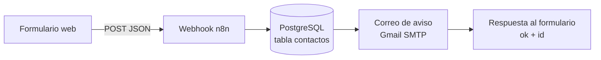
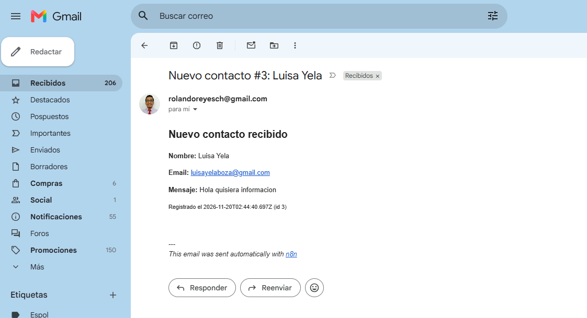
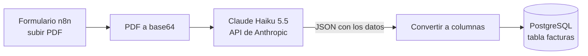
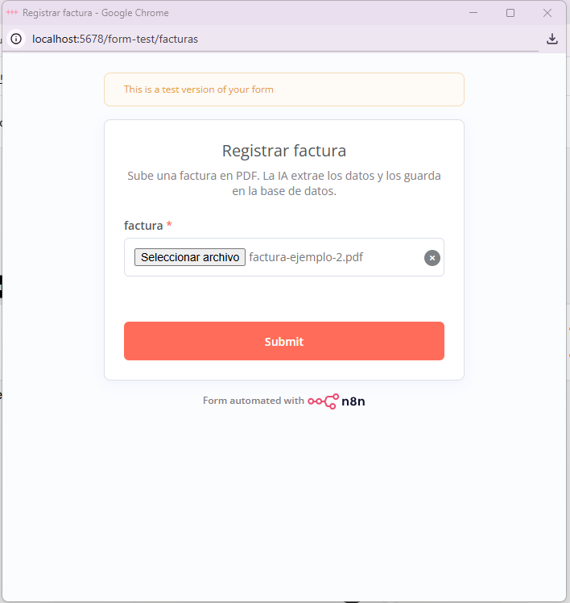
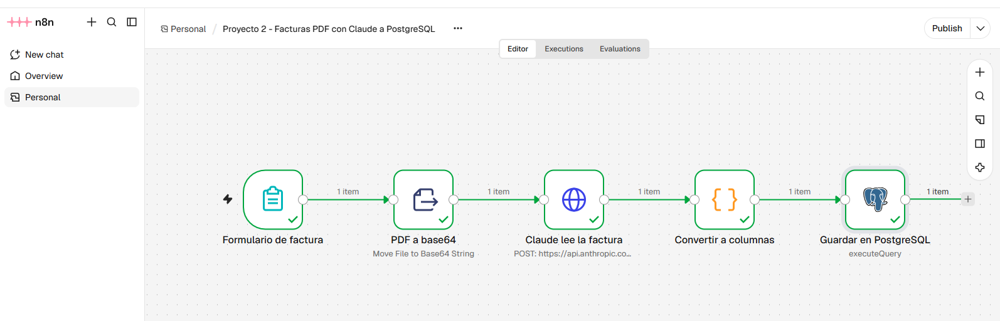
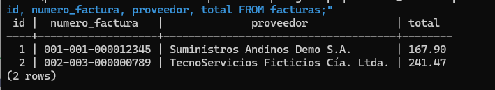

# Automatizaciones con n8n

Portafolio de flujos de automatización construidos con **n8n**, **PostgreSQL**, **Docker** e **IA (Claude)**, listos para ejecutarse en cualquier computadora con un solo comando.

| # | Proyecto | Estado |
|---|----------|--------|
| 1 | [Captura automática de contactos (webhook → PostgreSQL → correo)](#proyecto-1-captura-automática-de-contactos) | ✅ Terminado |
| 2 | [Lectura de facturas PDF con IA (PDF → Claude → PostgreSQL)](#proyecto-2-lectura-de-facturas-pdf-con-ia) | ✅ Terminado |

---

## Proyecto 1: Captura automática de contactos

### El problema
Muchos negocios reciben contactos desde su página web y los copian a mano en una hoja de cálculo, o se enteran tarde de que alguien escribió. Eso significa clientes potenciales perdidos y tiempo gastado en tareas repetitivas.

### La solución
Un flujo en n8n que, en cuanto alguien llena el formulario:

1. **Recibe** los datos por un webhook.
2. **Guarda** el contacto en una base de datos PostgreSQL (con fecha y hora).
3. **Avisa** al equipo por correo al instante, con todos los datos del contacto.
4. **Responde** al formulario confirmando que el mensaje quedó registrado.

**Resultado:** cero trabajo manual, ningún contacto se pierde y el equipo puede responder en minutos.

### Diagrama del flujo



### Capturas

**Formulario de contacto**


**Flujo en n8n ejecutado con éxito**


**Correo de aviso recibido**


### Tecnologías

- **n8n**: orquestación del flujo (webhook, base de datos, correo).
- **PostgreSQL 16**: almacenamiento de los contactos.
- **Docker Compose**: levanta n8n y PostgreSQL juntos.
- **Gmail SMTP**: envío del correo de aviso.
- **HTML + JavaScript**: formulario de demostración.

### Estructura del repositorio

```
├── docker-compose.yml          # n8n + PostgreSQL
├── .env.example                # variables de entorno (copiar como .env)
├── init-db/
│   └── 01-portafolio.sql       # crea la base "portafolio" y sus tablas
├── workflows/
│   ├── proyecto1-webhook-postgres-correo.json   # flujo del proyecto 1
│   └── proyecto2-facturas-claude-postgres.json  # flujo del proyecto 2
├── demo/
│   ├── formulario-contacto.html                 # formulario de prueba (proyecto 1)
│   └── facturas-ejemplo/                        # facturas ficticias (proyecto 2)
├── facturas/                   # facturas reales (ignorada por git)
└── docs/capturas/              # imágenes del README
```

### Cómo ejecutarlo

**Requisitos:** Docker Desktop instalado y abierto.

1. Clona el repositorio y entra a la carpeta:
   ```bash
   git clone https://github.com/roreyes83/automatizaciones-n8n.git
   cd automatizaciones-n8n
   ```
2. Copia `.env.example` como `.env` y cambia la clave y la llave de cifrado.
3. Levanta los servicios:
   ```bash
   docker compose up -d
   ```
4. Abre http://localhost:5678, crea tu cuenta de n8n e importa `workflows/proyecto1-webhook-postgres-correo.json`.
5. Crea dos credenciales en n8n:
   - **Postgres**: host `postgres`, base `portafolio`, usuario y clave del `.env`.
   - **SMTP**: `smtp.gmail.com`, puerto 465, SSL, con una [contraseña de aplicación de Gmail](https://myaccount.google.com/apppasswords).
6. Asigna las credenciales a los nodos, pon tu correo en el nodo **Enviar correo** y activa el flujo.
7. Abre `demo/formulario-contacto.html` en el navegador y envía un mensaje.

También puedes probarlo desde la terminal:
```bash
curl -X POST http://localhost:5678/webhook/contacto \
  -H "Content-Type: application/json" \
  -d '{"nombre":"Ana Perez","email":"ana@ejemplo.com","mensaje":"Hola"}'
```

### Posibles mejoras
- Validar el formato del email antes de guardar.
- Enviar también una respuesta automática al cliente.
- Publicar el flujo en un servidor en la nube para recibir contactos reales.

## Proyecto 2: Lectura de facturas PDF con IA

### El problema
En muchas empresas alguien pasa horas copiando a mano los datos de cada factura (número, fecha, proveedor, RUC, montos) a una hoja de cálculo o al sistema contable. Es lento, aburrido y se cometen errores de digitación.

### La solución
Un flujo en n8n con inteligencia artificial que:

1. **Recibe** la factura en PDF desde un formulario web.
2. **Envía** el PDF a **Claude** (modelo Claude Haiku 5.5 de Anthropic), que lo lee como lo haría una persona.
3. **Extrae** los datos clave en un formato fijo (JSON con esquema): número de factura, fecha de emisión, proveedor, RUC, cliente, subtotal, IVA, total y moneda.
4. **Guarda** una fila nueva en la tabla `facturas` de PostgreSQL y muestra el resultado en pantalla.

**Resultado:** una factura se registra en segundos, sin digitar nada, por menos de un centavo por documento.

### Diagrama del flujo



### Capturas

**Formulario para subir la factura**


**Flujo en n8n ejecutado con éxito**


**Datos guardados en PostgreSQL**


### Detalles técnicos
- La llamada a Claude se hace con el nodo **HTTP Request** a `https://api.anthropic.com/v1/messages`, enviando el PDF como documento en base64.
- Se usa **salida estructurada** (`output_config.format` con un JSON Schema), así la IA siempre responde con los mismos campos y el flujo no se rompe.
- Si un dato no aparece en la factura, la IA devuelve vacío o 0 en lugar de inventarlo.
- La clave de la API se guarda como credencial cifrada de n8n (Header Auth `x-api-key`), nunca dentro del flujo ni en el repositorio.

### Cómo ejecutarlo

Con los servicios ya levantados (pasos 1 a 3 del proyecto 1):

1. Crea una API key en [console.anthropic.com](https://console.anthropic.com) (requiere saldo; con $5 alcanza para miles de facturas). Pon un límite de gasto.
2. En n8n crea una credencial **Header Auth** llamada `Claude API`: Name `x-api-key`, Value tu clave.
3. Importa `workflows/proyecto2-facturas-claude-postgres.json` y asigna las credenciales a **Claude lee la factura** (Claude API) y **Guardar en PostgreSQL** (Postgres).
4. Pulsa **Execute workflow**, sube `demo/facturas-ejemplo/factura-ejemplo-1.pdf` y envía.
5. Revisa los datos guardados:
   ```bash
   docker compose exec postgres psql -U n8n_user -d portafolio -c "SELECT * FROM facturas;"
   ```

> Las facturas de `demo/facturas-ejemplo/` son ficticias. La carpeta `facturas/` está en `.gitignore` para no subir facturas reales.

### Posibles mejoras
- Leer facturas que lleguen por correo como adjunto, sin usar el formulario.
- Detectar facturas duplicadas por número y RUC antes de guardar.
- Validar que subtotal + IVA = total y avisar por correo si no cuadra.
- Exportar las facturas del mes a Google Sheets o Excel.

---

## Autor

**Rolando Reyes** (www.linkedin.com/in/rolando-reyes-chavez) · [GitHub](https://github.com/roreyes83)