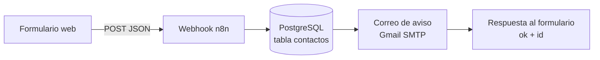
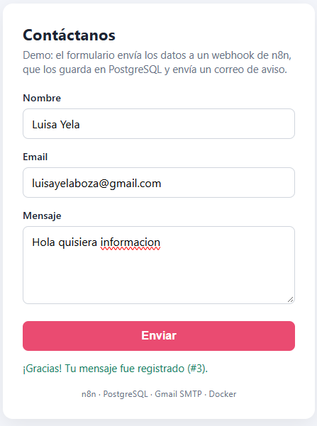
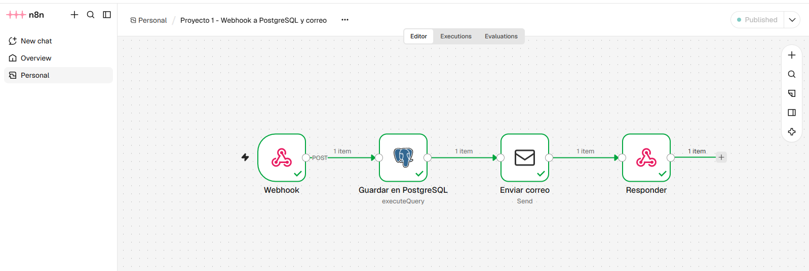

# Automatizaciones con n8n

Portafolio de flujos de automatización construidos con **n8n**, **PostgreSQL** y **Docker**, listos para ejecutarse en cualquier computadora con un solo comando.

| # | Proyecto | Estado |
|---|----------|--------|
| 1 | [Captura automática de contactos (webhook → PostgreSQL → correo)](#proyecto-1-captura-automática-de-contactos) | ✅ Terminado |
| 2 | Lectura de facturas PDF con IA y registro en base de datos | 🚧 En construcción |

---

## Proyecto 1: Captura automática de contactos

### El problema
Muchos negocios reciben contactos desde su página web y los copian a mano en una hoja de cálculo, o se enteran tarde de que alguien escribió. Eso significa clientes potenciales perdidos y tiempo gastado en tareas repetitivas.

### La solución
Un flujo en n8n que, en cuanto alguien llena el formulario:

1. **Recibe** los datos por un webhook.
2. **Guarda** el contacto en una base de datos PostgreSQL (con fecha y hora).
3. **Avisa** al equipo por correo al instante, con todos los datos del contacto.
4. **Responde** al formulario confirmando que el mensaje quedó registrado.

**Resultado:** cero trabajo manual, ningún contacto se pierde y el equipo puede responder en minutos.

### Diagrama del flujo



### Capturas

**Formulario de contacto**


**Flujo en n8n ejecutado con éxito**


**Correo de aviso recibido**


### Tecnologías

- **n8n**: orquestación del flujo (webhook, base de datos, correo).
- **PostgreSQL 16**: almacenamiento de los contactos.
- **Docker Compose**: levanta n8n y PostgreSQL juntos.
- **Gmail SMTP**: envío del correo de aviso.
- **HTML + JavaScript**: formulario de demostración.

### Estructura del repositorio

```
├── docker-compose.yml          # n8n + PostgreSQL
├── .env.example                # variables de entorno (copiar como .env)
├── init-db/
│   └── 01-portafolio.sql       # crea la base "portafolio" y sus tablas
├── workflows/
│   └── proyecto1-webhook-postgres-correo.json   # flujo exportado de n8n
├── demo/
│   └── formulario-contacto.html                 # formulario de prueba
└── docs/capturas/              # imágenes del README
```

### Cómo ejecutarlo

**Requisitos:** Docker Desktop instalado y abierto.

1. Clona el repositorio y entra a la carpeta:
   ```bash
   git clone https://github.com/roreyes83/automatizaciones-n8n.git
   cd automatizaciones-n8n
   ```
2. Copia `.env.example` como `.env` y cambia la clave y la llave de cifrado.
3. Levanta los servicios:
   ```bash
   docker compose up -d
   ```
4. Abre http://localhost:5678, crea tu cuenta de n8n e importa `workflows/proyecto1-webhook-postgres-correo.json`.
5. Crea dos credenciales en n8n:
   - **Postgres**: host `postgres`, base `portafolio`, usuario y clave del `.env`.
   - **SMTP**: `smtp.gmail.com`, puerto 465, SSL, con una [contraseña de aplicación de Gmail](https://myaccount.google.com/apppasswords).
6. Asigna las credenciales a los nodos, pon tu correo en el nodo **Enviar correo** y activa el flujo.
7. Abre `demo/formulario-contacto.html` en el navegador y envía un mensaje.

También puedes probarlo desde la terminal:
```bash
curl -X POST http://localhost:5678/webhook/contacto \
  -H "Content-Type: application/json" \
  -d '{"nombre":"Ana Perez","email":"ana@ejemplo.com","mensaje":"Hola"}'
```

### Posibles mejoras
- Validar el formato del email antes de guardar.
- Enviar también una respuesta automática al cliente.
- Publicar el flujo en un servidor en la nube para recibir contactos reales.

---

## Autor

**Rolando** (agrega tu apellido y LinkedIn aquí) · [GitHub](https://github.com/roreyes83)
